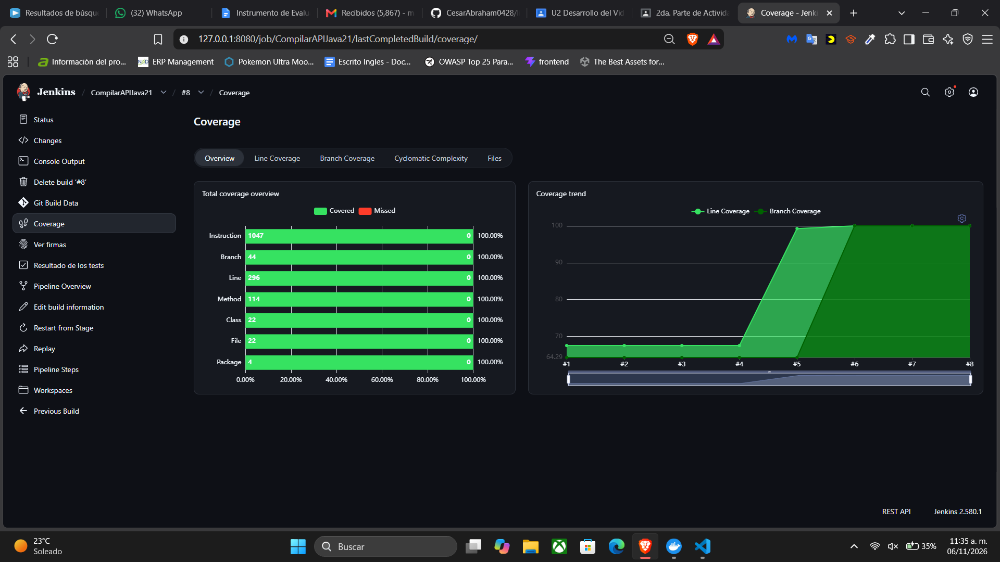
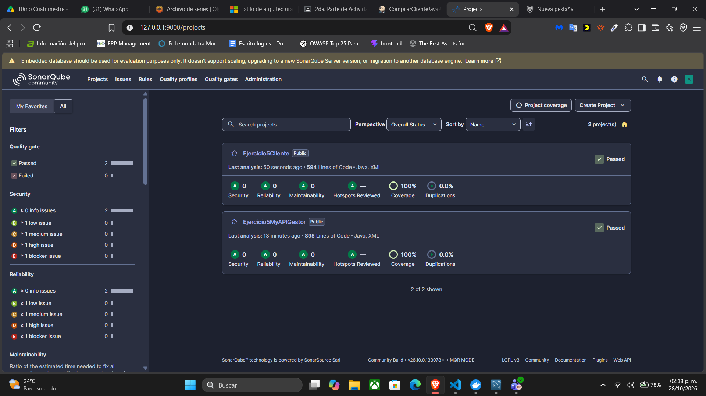
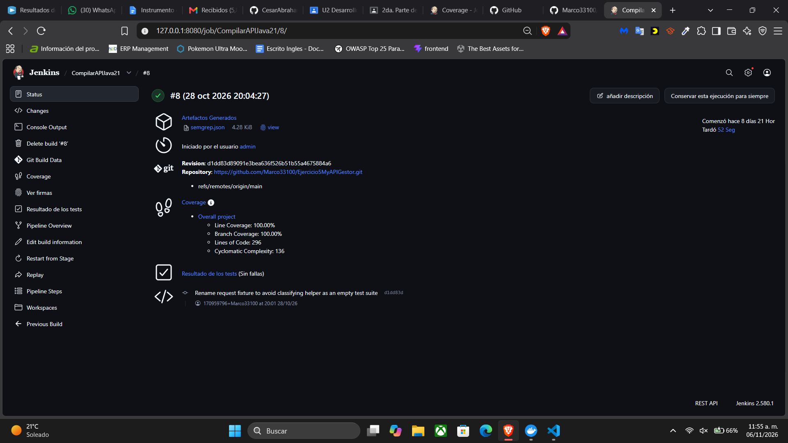
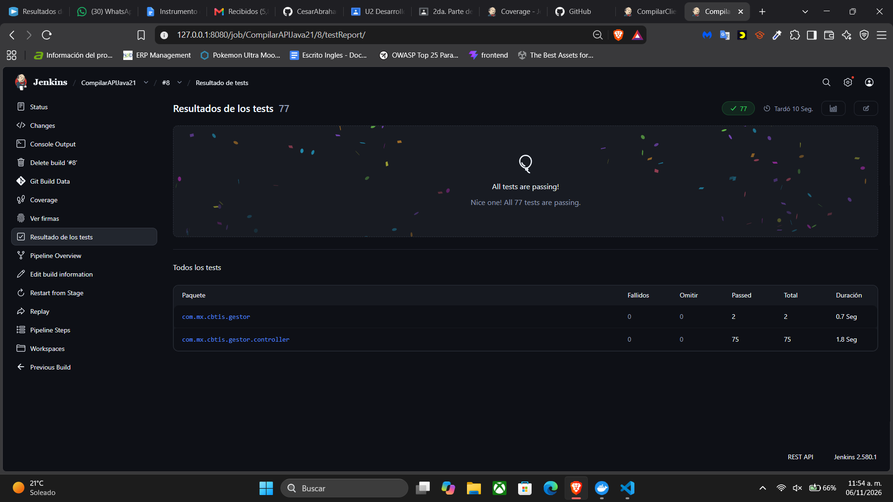
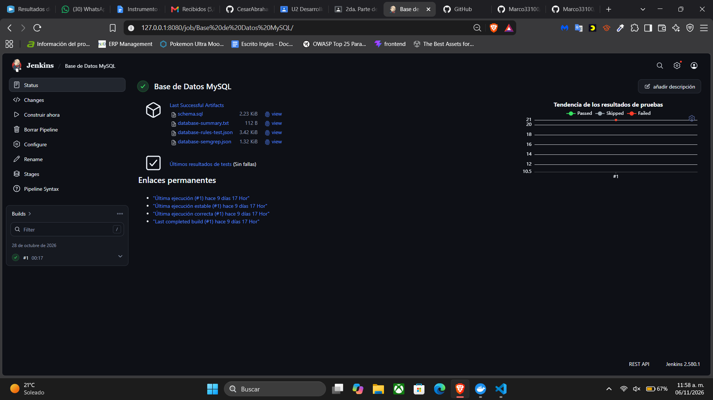
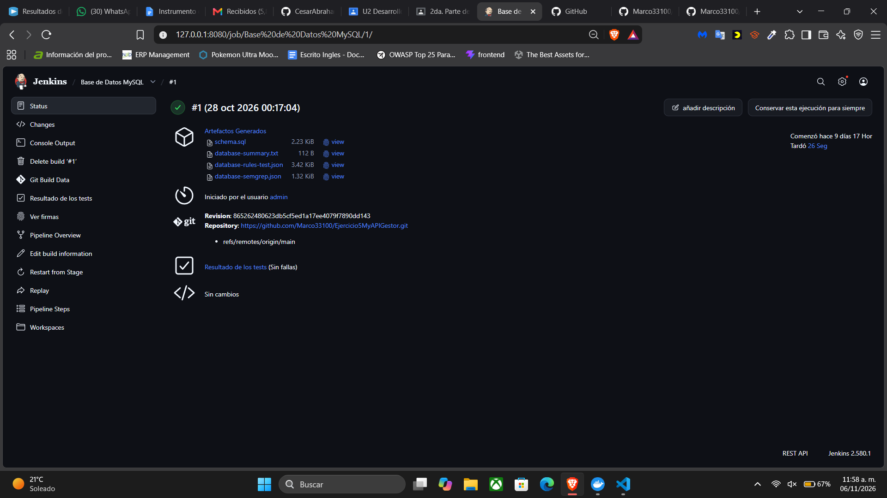

# Ejercicio5MyAPIGestor

API REST del gestor de proyectos con Java 21, Spring Boot 2.7.17, Spring Data JPA y MySQL. Escucha en el puerto 8081.

## Requisitos

- JDK 21 y `JAVA_HOME` configurado con ese JDK.
- Maven Wrapper incluido, configurado con Maven 3.9.11.
- Conexión a Internet en el primer uso para resolver dependencias.

## Preparar MySQL

Crea una base de desarrollo y un usuario con permisos sobre ella:

```sql
CREATE DATABASE IF NOT EXISTS dbgestor
  CHARACTER SET utf8mb4 COLLATE utf8mb4_unicode_ci;
```

Configura `DB_HOST`, `DB_PORT`, `DB_NAME`, `DB_USER` y `DB_PASSWORD`. Hibernate utiliza `ddl-auto=update`. Las pruebas de arranque necesitan una conexión MySQL; utiliza una base de pruebas separada y no datos de producción.

## Compilar y ejecutar en Windows

Desde la raíz del repositorio, en PowerShell:

```powershell
$env:DB_HOST = 'localhost'
$env:DB_PORT = '3306'
$env:DB_NAME = 'dbgestor'
$env:DB_USER = 'TU_USUARIO_MYSQL'
$env:DB_PASSWORD = 'TU_CONTRASENA_MYSQL'
.\mvnw.cmd clean verify
java -jar target/Ejercicio5MyAPIGestor-0.0.1-SNAPSHOT.jar
```

La API queda en [http://localhost:8081](http://localhost:8081). La raíz no contiene una página web; la interfaz está en el repositorio del cliente.

En Linux o macOS utiliza `./mvnw` y configura las mismas variables de entorno si corresponde.

## Pruebas y cobertura

Resultado conservado de Jenkins **CompilarAPIJava21 #8**, verificado el **28 de octubre de 2026**: **SUCCESS**. 77 pruebas aprobadas; 114/114 métodos, 296/296 líneas y 44/44 ramas cubiertos al 100 %. No hubo fallos, errores ni omisiones. Estas evidencias corresponden a esa revisión y no implican que se haya ejecutado una compilación nueva al editar este README.

Las pruebas comprueban controladores, contratos HTTP y JSON, entradas nulas, IDs de altas, borrados, conservación del rol y arranque real con MySQL de CI. Las 18 entradas HTTP señaladas se sustituyeron por DTO y los cinco controladores reciben sus repositorios mediante constructor.

`clean verify` ejecuta Surefire y genera `target/site/jacoco/index.html` y `target/site/jacoco/jacoco.xml`. Coverage de Jenkins publica el XML. No se añadieron exclusiones manuales de clases o métodos. La cobertura mide ejecución del código Java; no acredita la calidad completa de las aserciones ni la cobertura visual de HTML o JavaScript.

Consulta el [detalle de cobertura](docs/cobertura-100.md).

## Jenkins

Configura las herramientas `JDK21` con ruta `/opt/java/openjdk` y `Maven3` con versión 3.9.11. Crea el trabajo **CompilarAPIJava21**, selecciona **Pipeline script** y pega el [Jenkinsfile](Jenkinsfile) completo. Activa **Use Groovy Sandbox**. El pipeline descarga `main`, muestra el POM y las versiones y ejecuta `clean verify` con `steps { dir('.') { sh ... } }`.

El trabajo obtiene `DB_USER` y `DB_PASSWORD` de la credencial `mysql-ci`; utiliza `dbgestor_ci` en `mysql-java21-ci:3306`. Jenkins y MySQL comparten la red `jenkins-java21-ci`. Publica JUnit y Coverage, envía SonarQube con la clave `Ejercicio5MyAPIGestor` y archiva `reportes/semgrep.json`. Requiere la instalación `SonarServer` con su token y Semgrep 1.181.0 instalado en el agente.

Consulta la [configuración de Jenkins y MySQL](docs/jenkins-java21.md). El [tercer pipeline de MySQL](database/Jenkinsfile), descrito en [su guía](docs/jenkins-mysql.md), valida el esquema con seis reglas SQL y ejecuta 21 pruebas en `dbgestor_pipeline_ci`. La ejecución #1 terminó en SUCCESS, con 21 pruebas aprobadas; su cobertura no se expresa como JaCoCo Java.

Un cambio del Jenkinsfile en GitHub no reemplaza automáticamente el texto de un trabajo configurado con Pipeline script. Para incorporar cambios del script, cópialo de nuevo a Jenkins.

## Herramientas Maven

El POM utiliza Java 21 y declara explícitamente Sonar Maven Plugin **5.5.0.6356**, JaCoCo **0.8.15** y Maven Surefire **3.5.4**. El análisis Sonar se ejecuta en una etapa independiente después de generar cobertura; declarar el plugin no envía un análisis por sí solo.

## Historial de la actualización

- [POM actual](pom.xml)
- [POM original](docs/pom-original.xml)
- [Cambios de Java 21 y plugins](docs/actualizacion-java21.md)
- [Repositorio del cliente](https://github.com/Marco33100/Ejercicio5Cliente)


## Evidencias de pruebas y análisis

La captura compartida el **6 de noviembre de 2026** muestra el resultado conservado de **CompilarAPIJava21 #8**: **100 %**, con 114/114 métodos, 296/296 líneas y 44/44 ramas. Los archivos adjuntos corresponden a la ejecución del **28 de octubre**, no a una compilación nueva.



### Reportes consultables desde GitHub

| Evidencia | Archivo o enlace |
| --- | --- |
| JaCoCo completo HTML | [Índice](evidencias/2026-10-28/jacoco/index.html) |
| JaCoCo XML | [Contadores y detalle](evidencias/2026-10-28/jacoco/jacoco.xml) |
| Pruebas JUnit | [Resumen de suites](evidencias/2026-10-28/pruebas.json) |
| Resultados Jenkins | [Resultado y extractos de consola](evidencias/2026-10-28/jenkins.json) |
| Origen e integridad | [Procedencia](evidencias/2026-10-28/ORIGEN.txt) y [SHA256](evidencias/2026-10-28/SHA256SUMS.txt) |
| Semgrep API | [Reporte JSON](evidencias/2026-10-28/semgrep.json) |
| Pruebas MySQL #1 | [21 pruebas aprobadas](evidencias/2026-10-28/pruebas-mysql.json) |
| Seguridad SQL | [Reglas probadas](evidencias/2026-10-28/database-rules-test.json) y [escaneo](evidencias/2026-10-28/database-semgrep.json) |

GitHub muestra el código de los archivos HTML. Para navegar el informe JaCoCo, descarga el repositorio completo y abre `evidencias/2026-10-28/jacoco/index.html`; conserva sus carpetas de estilos y páginas. El XML y los JSON se pueden consultar directamente en GitHub.

### Captura del análisis final de SonarQube

Evidencia compartida el **28 de octubre de 2026**: ambos proyectos aparecen con **Quality Gate aprobado**, **100 % de cobertura**, **0 incidencias de seguridad, fiabilidad y mantenibilidad** y **0 % de duplicación**. Esta imagen está guardada en GitHub y puede consultarse desde cualquier equipo, sin acceder a los servicios locales.



### Resultados de Jenkins

Capturas compartidas el **6 de noviembre de 2026** de la ejecución **#8 del 28 de octubre de 2026**. Las imágenes se muestran directamente en GitHub; no hace falta abrir Jenkins en localhost.

**Ejecución aprobada.** El estado muestra el commit analizado, cobertura de líneas del **100 %** y resultado de pruebas sin fallos.



**Pruebas automatizadas.** Jenkins registra **77 pruebas aprobadas**, **0 fallidas** y **0 omitidas**.



Los [resultados y extractos de consola](evidencias/2026-10-28/jenkins.json) y el [resumen de suites JUnit](evidencias/2026-10-28/pruebas.json) complementan las capturas. La cobertura JaCoCo y el análisis final de SonarQube se muestran arriba.

Semgrep de la API ejecutó **203 reglas sobre 49 archivos**, con **0 hallazgos**. El JSON registra una advertencia **PartialParsing en mvnw**, que limita el análisis completo de ese script. No se analizaron archivos target: se respetó su exclusión en .gitignore y se comprobó la lista scanned. El pipeline SQL excluye explícitamente target/** y **/target/** y encontró cero hallazgos con sus seis reglas.

### Pipeline de base de datos MySQL

El tercer pipeline valida el esquema SQL y ejecuta pruebas con JDBC en la base aislada `dbgestor_pipeline_ci`. La ejecución **#1 del 28 de octubre de 2026** terminó correctamente, con **21 pruebas aprobadas**, sin fallos ni omisiones. Las siguientes capturas se compartieron el **6 de noviembre de 2026** y están disponibles directamente en GitHub.

**Panel del trabajo y artefactos publicados.** Jenkins conserva `schema.sql`, `database-summary.txt`, `database-rules-test.json` y `database-semgrep.json`.



**Ejecución #1 aprobada.** Se identifica la revisión Git analizada y el resultado de pruebas sin fallos.



- [Resumen de las 21 pruebas de MySQL](evidencias/2026-10-28/pruebas-mysql.json).
- [Resumen de la base después de las pruebas](evidencias/2026-10-28/database-summary.txt).
- [Pruebas de las seis reglas de seguridad SQL](evidencias/2026-10-28/database-rules-test.json).
- [Reporte del escaneo SQL con cero hallazgos](evidencias/2026-10-28/database-semgrep.json).
- [Esquema SQL utilizado](database/src/main/resources/schema.sql).
- [Script del pipeline MySQL](database/Jenkinsfile).

Estas pruebas verifican el esquema y las operaciones de base de datos; su resultado no es un porcentaje de cobertura Java de JaCoCo. Consulta también la [clasificación y corrección de las incidencias de la API](docs/correcciones-sonarqube.md).

### Código y commits

- [DTO y constructores de los controladores](https://github.com/Marco33100/Ejercicio5MyAPIGestor/commit/e4ada884e90d725a8c2c0bbdeae2cfa93f34d720).
- [Auxiliar de pruebas correctamente identificado](https://github.com/Marco33100/Ejercicio5MyAPIGestor/commit/d1dd83d).
- [Pipeline MySQL aislado](https://github.com/Marco33100/Ejercicio5MyAPIGestor/commit/865262480623db5cf5ed1a17ee4079f7890dd143).
- [Historial completo](https://github.com/Marco33100/Ejercicio5MyAPIGestor/commits/main/).
